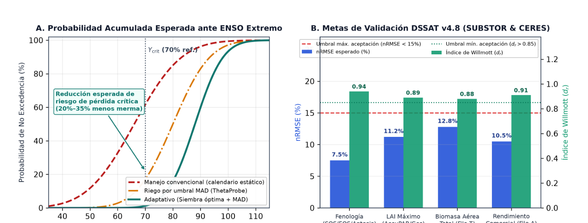
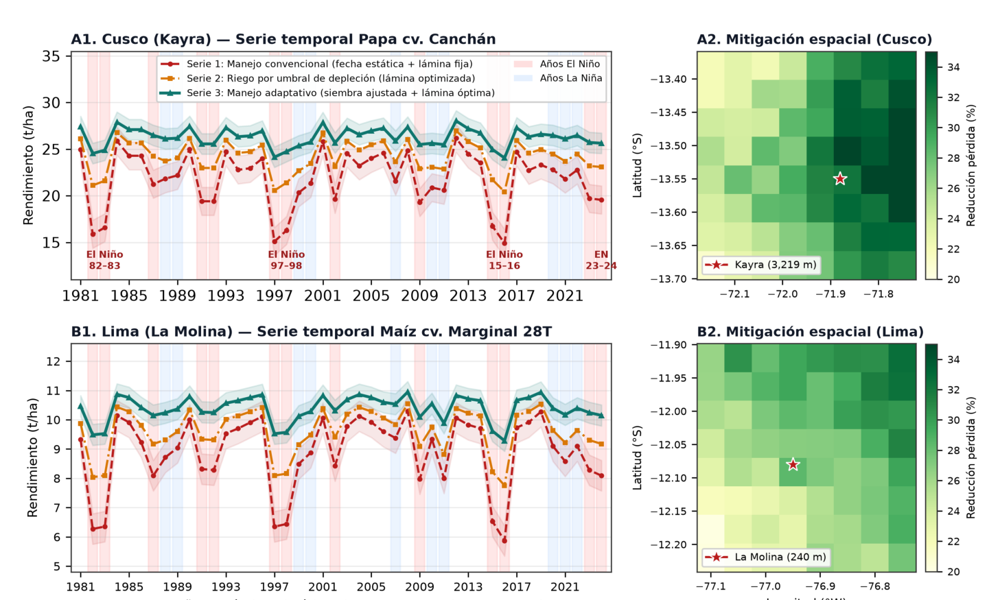

## Criterios Cuantitativos de Validación

## Simulación Espaciotemporal Esperada (1981–2024)

## Contrastación de Hipótesis

| Componente | Resultado Científico Esperado | Criterio de Validación |
| :--- | :--- | :--- |
| **Hipótesis 1 (OE 1: Hidrofísica)** | Curvas pF en Ollas de Richards + ajuste van Genuchten y cuantificación del sesgo de pedotransferencia. | Reducción del error en agua útil y ahorro de riego del **20% al 30%** sin pérdida comercial. |
| **Hipótesis 2 (OE 2: Ecofisiología)** | Curvas continuas de dosel (ESP32-CAM), coeficientes calibrados (Canchán y Marginal 28T) y relación estrés-nutrición. | Calibración DSSAT con **nRMSE < 15%** e índice de Willmott **d > 0.85**. |
| **Hipótesis Central (OE 3: ENSO)** | Reconstrucción de 44 campañas (1981–2024, PISCO v3.0) y ventanas de siembra de mínimo riesgo. | Interacción significativa (p < 0.05) y reducción proyectada de pérdidas del **20% al 35%**. |

## Metas de Producción Académica (PROCIENCIA)

- **2 artículos científicos** en revistas indizadas en Scopus o WoS (Q1/Q2) en acceso abierto.
- **2 tesis de pregrado** sustentadas (UNALM y UNSAAC).
- **1 tesis de maestría** sustentada (UNSAAC).
- **1 ponencia** en congreso internacional y **actividades de divulgación** con clubes de ciencias escolares y juntas de usuarios de agua.
