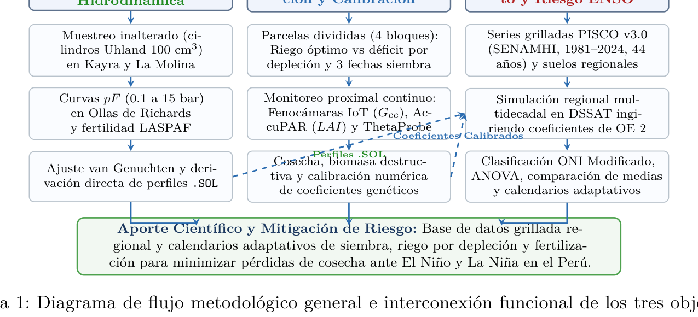
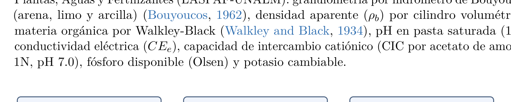
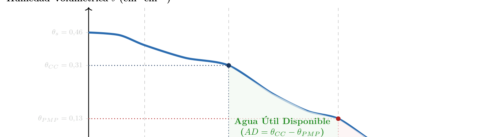
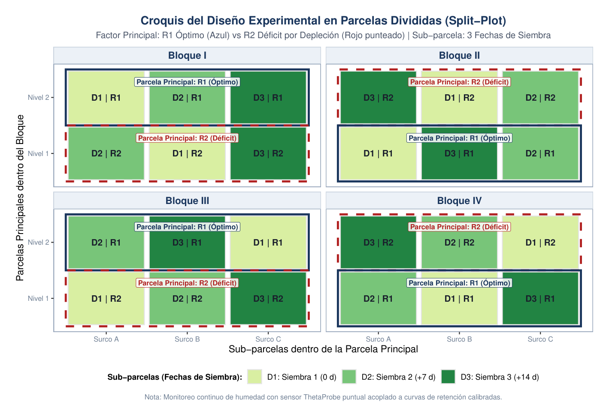
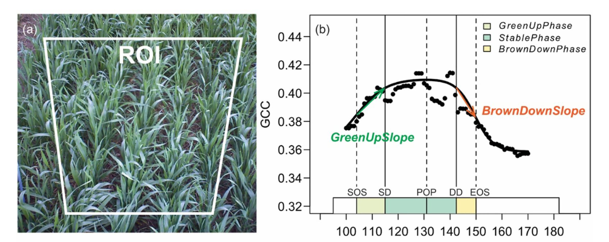
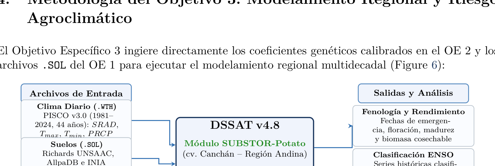

La investigación adopta un diseño cuantitativo, experimental y biofísico acoplado entre la sierra andina (**Centro Experimental K'ayra, Cusco · 3,219 msnm**) y la costa central (**Campus UNALM, La Molina, Lima · 240 msnm**).

## OE 1: Caracterización Hídrico-Edáfica Experimental

- **Muestreo estratigráfico:** Calicatas de 1.5 × 1.5 × 1.2 m y extracción de cilindros Uhland (100 cm³) en tres profundidades (0–20, 20–40 y 40–60 cm) por cuadruplicado.
- **Curvas pF en Ollas de Richards (UNSAAC):** Saturación capilar de 48 h y presiones de 0.10, 0.33, 1.0, 3.0, 5.0 y 15.0 bar (Modelos 1600 y 1500).
- **Fertilidad LASPAF-UNALM:** Granulometría Bouyoucos, densidad aparente, materia orgánica (Walkley-Black), pH, CE, CIC, P (Olsen) y K.
- **Ajuste van Genuchten:** Optimización Levenberg-Marquardt para derivar `SAT`, `DUL` y `LL` directos en archivos `.SOL`.

## OE 2: Experimentación Split-Plot, Fenocámaras IoT y LENA

- **Diseño experimental:** 4 bloques completos al azar en parcelas divididas (*split-plot*), 2 regímenes hídricos (`R1` óptimo vs. `R2` déficit controlado por depleción MAD 50–60% AD) y 3 fechas de siembra semanales (`D1, D2, D3`): 24 sub-parcelas por localidad.
- **Fenotipado proximal continuo:** 8 fenocámaras IoT (`ESP32-CAM`, 1.5 m en papa y 2.5 m en maíz, inclinación 60°), cálculo de `GCC` y ajuste logístico doble (`SOS`, `SD`, `POP`, `EOS`, `DD`).
- **Ceptometría y humedad:** `AccuPAR LP-80` (`fPAR`/`LAI`), sensor puntual `ThetaProbe ML3` (0–20 y 20–40 cm), muestreos destructivos quincenales y análisis bromatológico en `LENA-UNALM`.

## OE 3: Modelamiento Regional DSSAT v4.8 y Análisis ENSO

- **Entradas:** Series diarias **PISCO v3.0** (1981–2024, `.WTH`), suelos regionales (`AllpaDB`, `INIA`, `SoilGrids 2.0`) y coeficientes calibrados (`SUBSTOR-Potato` y `CERES-Maize`).
- **Clasificación y estadística:** Índice `ONI_agr` (SON–DJF), ANOVA multifactorial (Fase ENSO × Riego × Fecha de Siembra) y pruebas Tukey/Duncan (`α = 0.05`).

